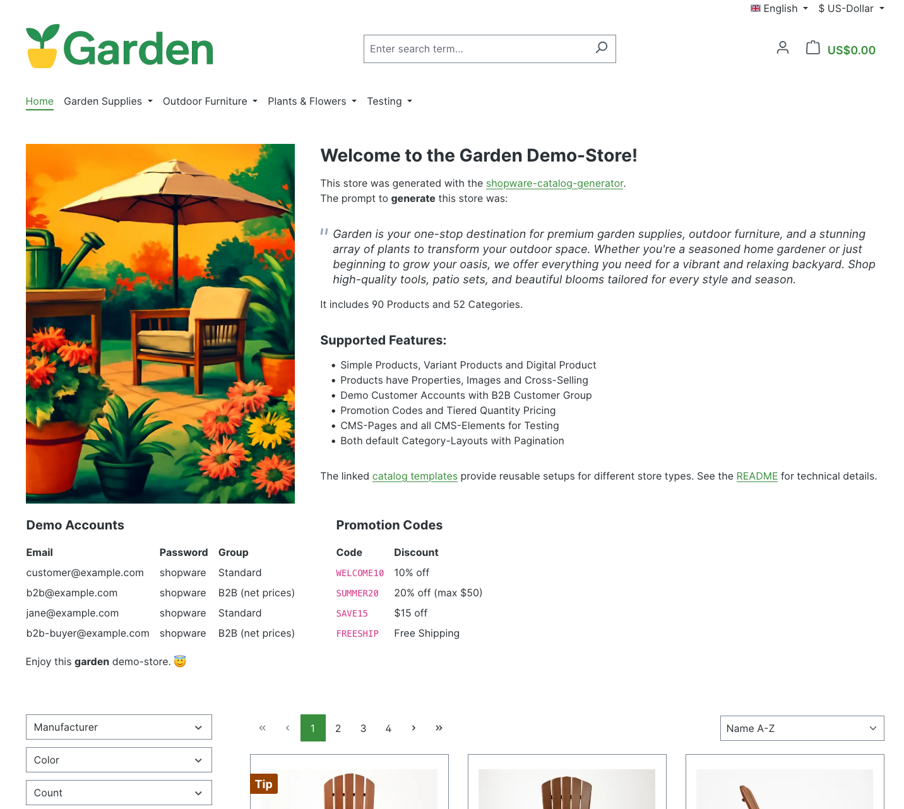
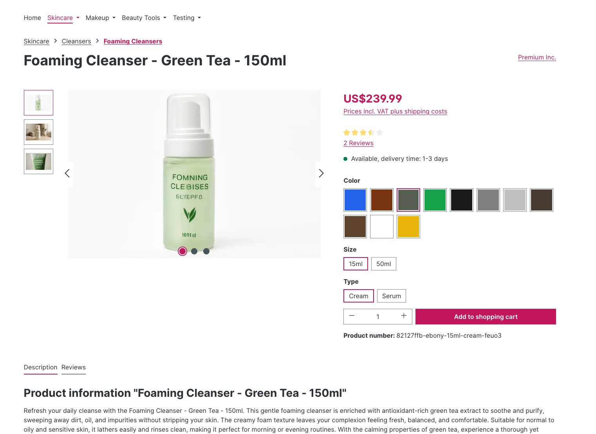

# Shopware Catalog Templates

Pre-generated AI-powered demo catalogs for [Shopware](https://www.shopware.com/), complete with category trees, products, descriptions, images, reviews, variants, CMS pages, and themed storefronts with AI-generated brand colors, logo, and favicon.

This repository serves as a template store for catalogs generated by the [shopware-catalog-generator](https://github.com/shopwareLabs/shopware-catalog-generator).

## Purpose

Instead of regenerating catalog data from scratch each time, you can use these pre-built templates to:

- Skip AI generation phases entirely
- Quickly populate development environments with realistic product data
- Share consistent demo data across teams
- Save time and API costs on image generation

## What's Included

Each template provides a fully-featured SalesChannel with:

- **~90 products** across **~63 categories** with a deep category tree
- **AI-generated descriptions** and product names
- **Product images** with multiple views per product (front, side, detail, lifestyle, packaging)
- **Category banner images** for category listing pages
- **Variant products** with properties like color and size
- **Manufacturers** with fictional brand definitions
- **Product reviews** (0–10 per product with ratings)
- **Digital products** (e.g. Gift Cards)
- **CMS pages** covering all Shopware CMS elements (text, images, video, galleries, forms, commerce elements)
- **Themed storefront** with AI-generated brand colors, logo, and favicon
- **Store-specific properties** generated by AI based on store context
- **Multi-language support** — English (USD) and German (EUR) domains are created automatically if `de-DE` is installed in Shopware

## How Templates Work

When you run `generate --name=<name>` with the [shopware-catalog-generator](https://github.com/shopwareLabs/shopware-catalog-generator), the CLI automatically checks if a matching template exists. If found, it skips AI generation entirely and uploads the template directly:

1. Clones this template repository (first run) or pulls updates
2. If a template matches the name, copies data to local cache
3. Skips blueprint creation and AI hydration phases
4. Proceeds directly to Shopware upload

```bash
# Uses a pre-generated template (instant, no AI needed)
bun run generate --name=music

# Force AI generation even if a template exists
bun run generate --name=music --no-template
```

> Templates require git access via SSH keys or credential helper.

## Repository Structure

```
generated/
├── properties/                    # Universal property groups (shared across stores)
│   ├── index.json                 # Index of global property groups
│   └── color.json                 # Color options with hex codes
│
└── sales-channels/                # Pre-built sales channel templates
    └── {store-name}/
        ├── blueprint.json         # Category structure and product placeholders
        ├── hydrated-blueprint.json # AI-generated product content
        ├── cms-blueprint.json     # CMS page structure and slot content
        ├── cms-landing-pages.json # CMS landing page definitions
        ├── manufacturers.json     # Manufacturer/brand definitions
        ├── digital-product.json   # Digital product definitions
        ├── metadata.json          # Store metadata (name, description, creation date)
        ├── properties/            # Store-specific property groups
        │   ├── index.json         # Index of store properties
        │   └── *.json             # Property definitions (size, material, etc.)
        ├── images/                # Generated images
        │   ├── product_media/     # Product images and metadata
        │   ├── category_media/    # Category banner images and metadata
        │   ├── cms_media/         # CMS page images and metadata
        │   └── theme_media/       # Storefront branding (logo, favicon, share image)
        └── metadata/              # Additional product metadata
            └── *.json             # Per-product metadata files
```

### Property System

Properties are split between global and store-specific:

- **Universal properties** (`generated/properties/`): Shared across all stores (e.g., Color with hex codes)
- **Store-specific properties** (`generated/sales-channels/{store}/properties/`): Context-aware properties generated by AI based on store type

This ensures:
- Beauty stores get properties like `Volume`, `Scent`, `Skin Type`
- Music stores get properties like `Pickup Configuration`, `Body Shape`, `String Count`
- Garden stores get properties like `Plant Type`, `Sun Exposure`, `Pot Size`

## Available Templates

| Template | Description |
|----------|-------------|
| **beauty** | Beauty and cosmetics store with skincare, makeup, and personal care products |
| **garden** | Garden and outdoor store with plants, tools, and outdoor furniture |
| **music** | Musical instruments store with guitars, pianos, drums, and accessories |

## Examples

Here's what a generated demo store looks like in Shopware:

### Homepage

The store homepage with navigation, hero content, and paginated product listings.



### Category Page

Category pages with banner images, property filters, and product grids.


### Product Detail Page

Product detail pages with variant selection (color, size), descriptions, properties, and reviews.



### CMS Landing Pages

CMS pages showcasing various layout elements like image-text blocks and galleries.


## Configuration

Override the default template repository in your `.env`:

```env
# Use a custom template repository
TEMPLATE_REPO_URL=git@github.com:your-org/your-templates.git

# Override local clone directory (default: .template-repo)
TEMPLATE_CACHE_DIR=.my-templates
```

## Contributing

Want to add a new template? Generate it using the [shopware-catalog-generator](https://github.com/shopwareLabs/shopware-catalog-generator) and submit a pull request with the complete `generated/sales-channels/{your-store}/` directory.

When regenerating all templates, squash the history to keep the repo size small using the [`reset-templates-history.sh`](https://github.com/shopwareLabs/shopware-catalog-generator/blob/main/scripts/reset-templates-history.sh) script from the generator:

```bash
bash scripts/reset-templates-history.sh /path/to/shopware-catalog-templates
```

For details on building, testing, and extending the generator itself, see the [shopware-catalog-generator README](https://github.com/shopwareLabs/shopware-catalog-generator#readme).

## Related Projects

- [shopware-catalog-generator](https://github.com/shopwareLabs/shopware-catalog-generator) — The tool that generates and consumes these templates

## License

MIT
